### Escuela Colombiana de Ingeniería
### Arquitecturas de Software - ARSW

## Escalamiento en Azure con Maquinas Virtuales, Sacale Sets y Service Plans

### Dependencias
* Cree una cuenta gratuita dentro de Azure. Para hacerlo puede guiarse de esta [documentación](https://azure.microsoft.com/es-es/free/students/). Al hacerlo usted contará con $100 USD para gastar durante 12 meses.
Antes de iniciar con el laboratorio, revise la siguiente documentación sobre las [Azure Functions](https://www.c-sharpcorner.com/article/an-overview-of-azure-functions/)

### Parte 0 - Entendiendo el escenario de calidad

Adjunto a este laboratorio usted podrá encontrar una aplicación totalmente desarrollada que tiene como objetivo calcular el enésimo valor de la secuencia de Fibonnaci.

**Escalabilidad**
Cuando un conjunto de usuarios consulta un enésimo número (superior a 1000000) de la secuencia de Fibonacci de forma concurrente y el sistema se encuentra bajo condiciones normales de operación, todas las peticiones deben ser respondidas y el consumo de CPU del sistema no puede superar el 70%.

---

## Desarrollo del laboratorio

### Recursos creados

| Recurso | Valor |
|---|---|
| Suscripción | Azure for Students |
| Grupo de recursos | `SCALABILITY_LAB_II` |
| Function App | `FunctionProjectFibonacci-jdq` |
| URL base | `https://functionprojectfibonacci-jdq-f3d5ckcuhxgse3ef.northcentralus-01.azurewebsites.net` |
| Plan de hospedaje | Consumo flexible (Flex Consumption), Linux, instancias de 2048 MB |
| Runtime | Node.js 22 LTS, Azure Functions host `~4`, modelo de programación v4 de Node.js |
| Región | North Central US |
| Storage Account | `scalabilitylabiibe86` |
| Application Insights | `FunctionProjectFibonacci-jdq` |

Endpoints desplegados:

* `POST /api/Fibonacci` (iterativo, versión original del laboratorio) con cuerpo `{"nth": <n>}`.
* `POST /api/FibonacciMemo` (recursivo con memoization) con cuerpo `{"nth": <n>}`.

Ambos aceptan también `GET ?nth=<n>`.

### Estructura del repositorio

```
.vscode/                     Configuración de la extensión de Azure Functions (deploySubpath = FunctionProject)
FunctionProject/
  host.json                  Host v2.0 con extension bundle [4.*, 5.0.0)
  package.json               main = src/functions/*.js, dependencias @azure/functions y big-integer
  src/functions/
    Fibonacci.js             Fibonacci iterativo (función original migrada al modelo v4)
    FibonacciMemo.js         Fibonacci recursivo con memoization (punto 6)
postman/
  ARSW_LAB10_Fibonacci.postman_collection.json
  ARSW_LAB10_FibonacciMemo.postman_collection.json
  ARSW_LAB10.postman_environment.json
  run-concurrent.sh          Lanza N ejecuciones de Newman en paralelo (punto 5)
  summarize.js               Resume los reportes de Newman
  memo-test.sh               Pruebas secuenciales de la función con memoization (punto 6)
  results/                   Logs y resúmenes de todas las pruebas
images/lab/                  Evidencias del laboratorio
```

### Cambios necesarios sobre el código entregado

El proyecto original estaba configurado para el runtime `~2` de Azure Functions, con el modelo de programación v3 de Node.js (`function.json` + `module.exports`), `proxies.json` y el extension bundle `[1.*, 2.0.0)`. Hoy Azure solo permite crear Function Apps con el runtime `~4`, el portal solo ofrece Node.js 22 y 24, y el plan Flex Consumption ejecuta el modelo de programación v4 de Node.js. Por eso se hicieron estos ajustes, sin cambiar el algoritmo:

* `host.json`: extension bundle actualizado a `[4.*, 5.0.0)`.
* Se eliminó `proxies.json`, porque los proxies no existen en el runtime `~4`.
* `Fibonacci/function.json` + `Fibonacci/index.js` pasaron a `src/functions/Fibonacci.js`, que usa `app.http(...)` de `@azure/functions` v4. El ciclo iterativo con `big-integer` es el mismo del laboratorio. Además se valida `nth` y se acepta tanto el cuerpo JSON como el query param.
* `package.json`: `"main": "src/functions/*.js"` y la dependencia `@azure/functions`.
* `.vscode/settings.json`: `projectRuntime` pasa a `~4` y se agrega `projectLanguageModel: 4` para que la extensión de VS Code despliegue correctamente.

---

### 1. Creación de la Function App

Se siguió la configuración de las imágenes del enunciado (Function App con código, Node.js, Storage Account nuevo, plan serverless). La suscripción **Azure for Students** impuso dos restricciones que obligaron a ajustar región y plan:

1. **Política de regiones permitidas.** La suscripción tiene la asignación `Allowed resource deployment regions` (`sys.regionrestriction`). Solo permite `brazilsouth`, `canadacentral`, `mexicocentral`, `chilecentral` y `northcentralus`. Los intentos en *West US 3* y *Central US* fallaron con `RequestDisallowedByAzure`.

   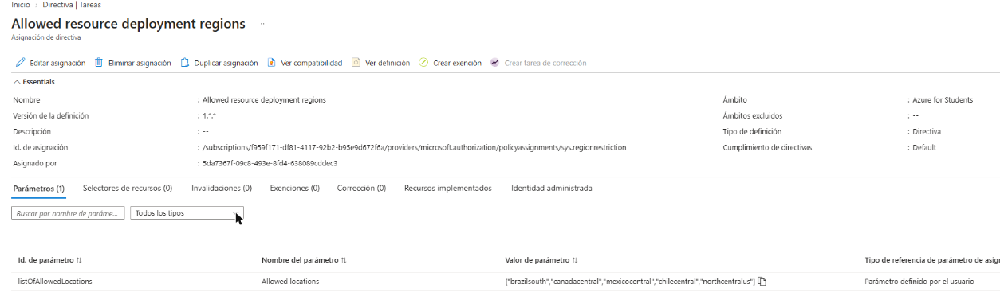

2. **Cuota del plan Consumo (Windows) en 0.** En las regiones permitidas, el plan *Consumo (Windows)* (SKU `Y1`, el de la imagen original) falló en la validación con `SubscriptionIsOverQuotaForSku: Current Limit (Y1 VMs): 0`. Por eso se usó **Consumo flexible (Flex Consumption)**, que es el plan serverless que Azure recomienda hoy para Functions. Este plan también escala a cero y cobra por ejecución. Corre sobre Linux.

Configuración final, en la pestaña **Datos básicos**:

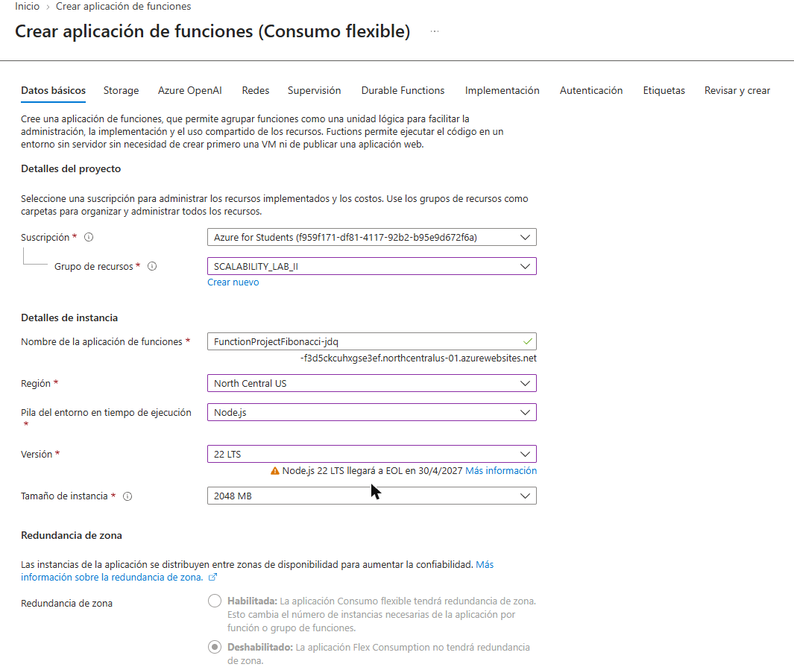

**Storage**, con una cuenta de almacenamiento nueva:

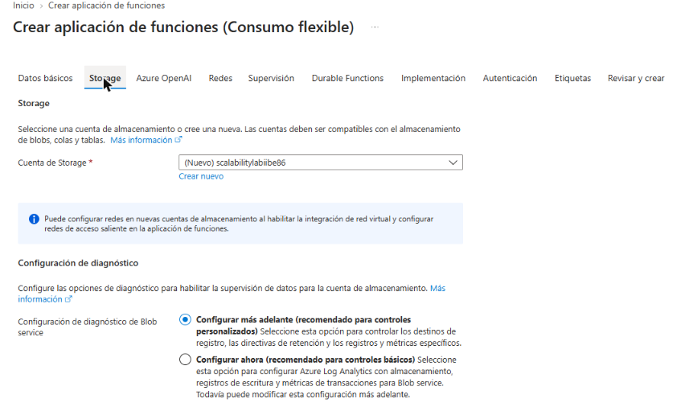

**Revisar y crear**:

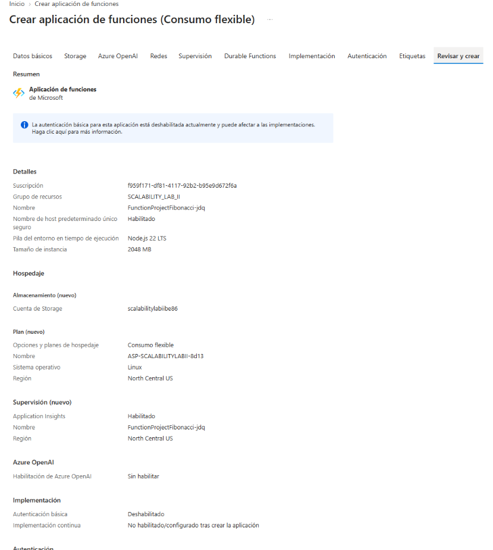

Implementación completada y Function App en ejecución:

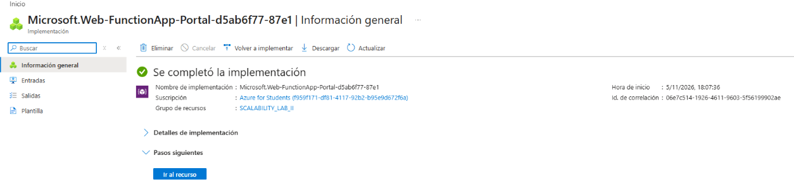

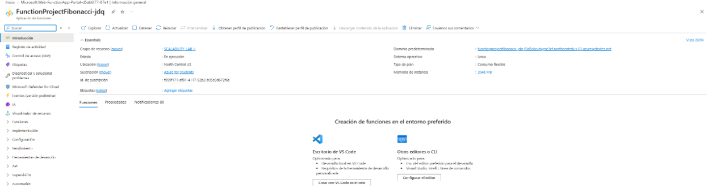

### 2. Extensión de Azure Functions para Visual Studio Code

La extensión **Azure Functions** (`ms-azuretools.vscode-azurefunctions`) está instalada en VS Code y además figura como recomendada en [.vscode/extensions.json](.vscode/extensions.json):

```
$ code --list-extensions --show-versions | grep -i azure
ms-azuretools.vscode-azurefunctions@1.22.2
ms-azuretools.vscode-azureresourcegroups@0.13.2
ms-azuretools.vscode-containers@2.5.3
```

### 3. Despliegue de la función Fibonacci

La configuración de VS Code ([.vscode/settings.json](.vscode/settings.json)) despliega la subcarpeta `FunctionProject`. Desde VS Code el flujo es *Azure (barra lateral) → Workspace → Deploy → Deploy to Function App… → FunctionProjectFibonacci-jdq*.

Para este laboratorio el paquete se publicó con el mismo mecanismo que usa la extensión: un *zip deploy* (OneDeploy) del contenido de `FunctionProject` con sus `node_modules`, ejecutado desde **Azure Cloud Shell**:

```bash
cd FunctionProject
npm install --omit=dev
zip -qr ../fp.zip .
az functionapp deployment source config-zip -g SCALABILITY_LAB_II -n FunctionProjectFibonacci-jdq --src ../fp.zip
```

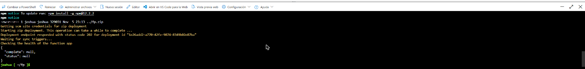

Funciones registradas después del despliegue (`az functionapp function list`):

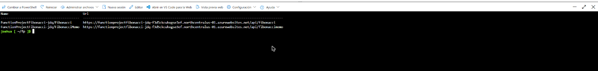

En el portal, ambas funciones aparecen con desencadenador HTTP y en estado *Habilitada*:

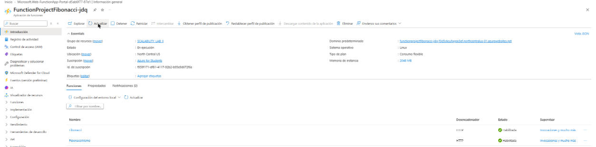

### 4. Prueba de la función en el portal

Desde *Fibonacci → Código y prueba → Prueba/ejecución* se envió un `POST` con cuerpo `{"nth": 100}`:

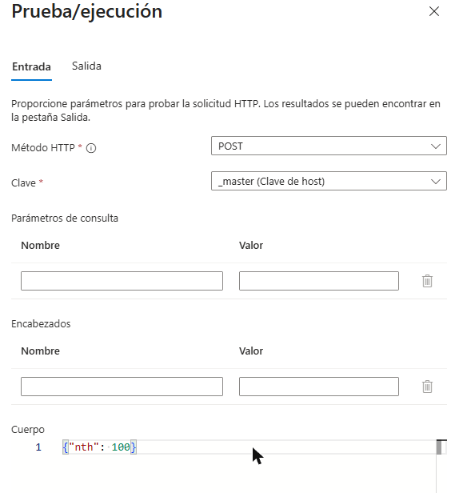

La respuesta fue `200` con el valor correcto `F(100) = 354224848179261915075`. El panel de registros muestra la invocación `Functions.Fibonacci (Succeeded, Duration=6ms)`:

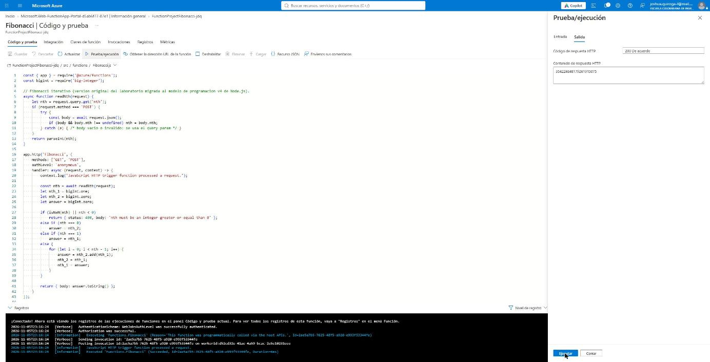

### 5. Pruebas concurrentes con Newman (10 peticiones) e informe

#### Colección y ejecución

* Colección: [postman/ARSW_LAB10_Fibonacci.postman_collection.json](postman/ARSW_LAB10_Fibonacci.postman_collection.json). Hace un `POST {{FUNCTION_URL}}/api/Fibonacci` con cuerpo `{"nth": {{NTH}}}` y tiene dos tests: el código de estado es 200 y el cuerpo es un número.
* Entorno: [postman/ARSW_LAB10.postman_environment.json](postman/ARSW_LAB10.postman_environment.json), con `FUNCTION_URL` y `NTH = 1000000`.
* Concurrencia: Newman ejecuta las iteraciones de una colección de forma secuencial. Por eso [postman/run-concurrent.sh](postman/run-concurrent.sh) lanza **10 procesos de Newman en paralelo** (`&` + `wait`), cada uno con una petición. Al final [postman/summarize.js](postman/summarize.js) consolida los resultados.

```bash
./postman/run-concurrent.sh 10 1000000
```

Los logs de cada proceso de Newman y el resumen de cada ronda quedaron en [postman/results/](postman/results/).

#### Resultados

Línea base: una sola petición `nth = 1000000` (respuesta de 208.988 dígitos) tarda unos **7,4 s**. Se midieron tres peticiones secuenciales con `curl`: 7,59 s, 7,29 s y 7,45 s.

| Ronda | Configuración de escalado | Exitosas | Mín | Máx | Promedio | Instancias que atendieron (App Insights) |
|---|---|---|---|---|---|---|
| 1 | Concurrencia HTTP por instancia asignada por el sistema | 10/10 | 14,2 s | 66,9 s | 61,2 s | 1 |
| 2 | Igual a la ronda 1 | 10/10 | 20,0 s | 65,0 s | 60,1 s | 1 |
| 3 | Concurrencia HTTP por instancia = 1 | 10/10 | 7,5 s | 8,5 s | 7,8 s | 9 |

Detalle de la ronda 1 ([resumen](postman/results/ronda1/resumen.txt)):

```
Concurrencia=10 nth=1000000 tiempo total=70s
run-1        status=200 tiempo=66618ms OK
run-2        status=200 tiempo=66142ms OK
run-3        status=200 tiempo=66721ms OK
run-4        status=200 tiempo=66103ms OK
run-5        status=200 tiempo=66681ms OK
run-6        status=200 tiempo=66885ms OK
run-7        status=200 tiempo=66669ms OK
run-8        status=200 tiempo=66382ms OK
run-9        status=200 tiempo=14167ms OK
run-10       status=200 tiempo=66036ms OK
Exitosas=10 Fallidas=0 Min=14167ms Max=66885ms Promedio=61240ms
```

Detalle de la ronda 3 ([resumen](postman/results/ronda3/resumen.txt)):

```
Concurrencia=10 nth=1000000 tiempo total=32s
run-1        status=200 tiempo=7658ms OK
run-2        status=200 tiempo=7901ms OK
run-3        status=200 tiempo=7518ms OK
run-4        status=200 tiempo=7548ms OK
run-5        status=200 tiempo=7456ms OK
run-6        status=200 tiempo=7548ms OK
run-7        status=200 tiempo=7820ms OK
run-8        status=200 tiempo=7528ms OK
run-9        status=200 tiempo=8217ms OK
run-10       status=200 tiempo=8460ms OK
Exitosas=10 Fallidas=0 Min=7456ms Max=8460ms Promedio=7765ms
```

Esta consulta en Application Insights agrupa las peticiones de `Fibonacci` de más de 3 s por instancia (`cloud_RoleInstance`):

```kusto
requests
| where timestamp > ago(2h) and name == 'Fibonacci' and duration > 3000
| summarize peticiones = count(), duracion_prom_s = round(avg(duration) / 1000, 1),
            duracion_max_s = round(max(duration) / 1000, 1)
  by instancia = cloud_RoleInstance, ventana = bin(timestamp, 5m)
| order by ventana asc
```

En las rondas 1 y 2 (más las 3 peticiones de la línea base), las **23 peticiones las atendió una sola instancia**, con una duración promedio de 52,6 s:

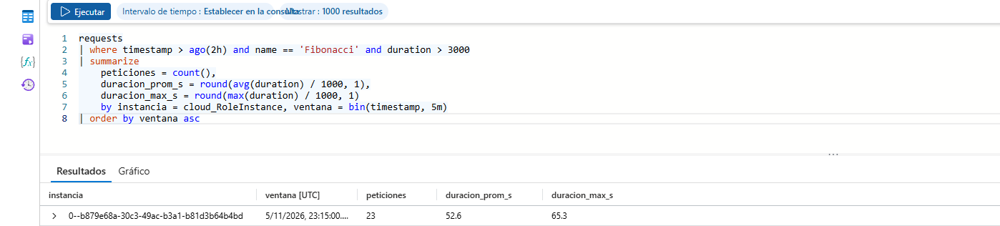

Para la ronda 3 se cambió *Configuración → Escala y simultaneidad → Simultaneidad HTTP por instancia* a **1**:

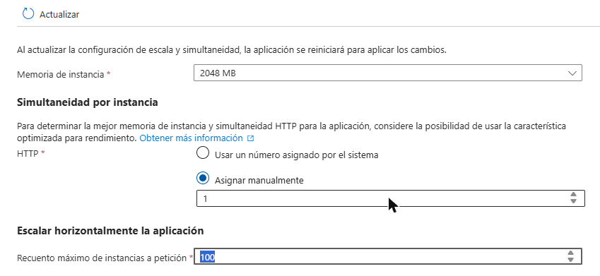

Con ese cambio, la plataforma repartió las 10 peticiones entre **9 instancias**, y cada una respondió en ~6,3 s:

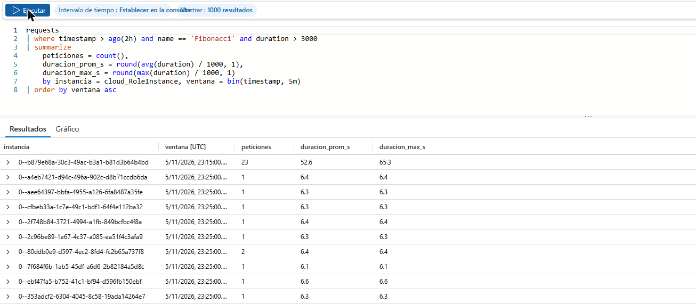

Después de la prueba se devolvió la configuración a *Usar un número asignado por el sistema*.

#### Informe

* **Todas las peticiones fueron respondidas.** Hubo 30 de 30 respuestas `200` en las tres rondas, sin timeouts. El plan Flex tiene un timeout por defecto de 30 minutos y el cliente se configuró con 300 s.
* **Con la configuración por defecto, la Function App no escala con 10 peticiones CPU-bound.** Flex Consumption escala según la concurrencia: para instancias de 2048 MB asigna por defecto 16 peticiones HTTP simultáneas por instancia. 10 peticiones caben en una instancia, así que el *scale controller* no agrega más.
* **Node.js ejecuta el código en un solo hilo.** El ciclo de Fibonacci es 100 % CPU y bloquea el event loop mientras calcula. Las 10 peticiones que llegaron a la misma instancia se procesaron una tras otra: 10 × ~6,5 s ≈ 65 s. Por eso la latencia promedio subió de 7,4 s a ~60 s. Una de las peticiones de cada ronda salió antes (14 s y 20 s) y las demás quedaron retenidas hasta que el event loop se liberó.
* **Ajustar la concurrencia por instancia al tipo de carga resuelve el problema.** Con 1 petición por instancia, Flex creó instancias nuevas casi de inmediato. La latencia volvió al valor de una petición aislada (~7,8 s promedio incluyendo red) y la ronda completa tomó 32 s, de los cuales ~20 s son el arranque de 10 procesos de Newman con `npx`.
* **CPU.** En serverless no se administra una VM, así que no hay un "% de CPU del sistema" que limitar como en las partes con VMs. Los contadores que publica Application Insights para Flex corresponden al proceso host de Functions (máximo 1,6 % / 0,4 % normalizado), no al worker de Node.js que ejecuta el cálculo:

  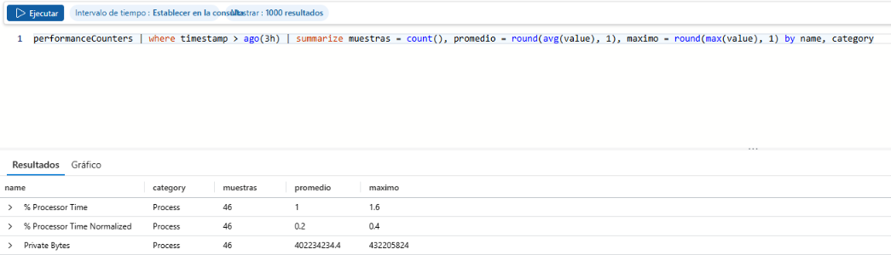

  El worker de Node usa un núcleo completo mientras calcula. La forma de cumplir el criterio "CPU ≤ 70 %" en este modelo es que ninguna instancia acumule más trabajo CPU-bound del que puede procesar, y eso se controla con la concurrencia por instancia. Con concurrencia 1, cada instancia procesa una sola petición y la capacidad total crece agregando instancias (hasta 100 en esta app, hasta 1000 en Flex).
* **Conclusión.** El escenario de calidad se cumple en disponibilidad desde el primer momento. En rendimiento solo se cumple cuando la regla de escalado está alineada con la naturaleza CPU-bound de la carga. El escalado horizontal automático del modelo serverless reemplaza al escalado manual o por reglas de las VMs y los Scale Sets.

### 6. Fibonacci recursivo con memoization

Código: [FunctionProject/src/functions/FibonacciMemo.js](FunctionProject/src/functions/FibonacciMemo.js).

```js
const memo = new Map();            // variable global del módulo: vive mientras viva la instancia
memo.set(0, bigInt.zero);
memo.set(1, bigInt.one);

function fibonacci(n) {
    if (memo.has(n)) return memo.get(n);
    const value = fibonacci(n - 1).add(fibonacci(n - 2));
    memo.set(n, value);
    return value;
}
```

Para observar el comportamiento, la función devuelve en las cabeceras el tamaño del memo antes y después de la llamada (`x-memo-size-before`, `x-memo-size-after`), si hubo acierto (`x-memo-hit`), el tiempo de cálculo y el momento en que arrancó la instancia (`x-instance-started-at`). Las pruebas se hicieron con [postman/memo-test.sh](postman/memo-test.sh), que llama secuencialmente a la función con `nth = 1000, 5000, 9000, 12000, 15000, 20000, 1000000`. La colección [postman/ARSW_LAB10_FibonacciMemo.postman_collection.json](postman/ARSW_LAB10_FibonacciMemo.postman_collection.json) permite hacer la misma prueba desde Postman/Newman.

**Pruebas repetidas, sin pausa** ([resultado completo](postman/results/memo/01-antes-de-inactividad.txt)):

```
== Prueba 1 (23:34:57 UTC)
nth      http   tiempo    memoHit    memoAntes   memoDesp    instanciaIniciada         cuerpo
1000     200    1.370663s false      2           1001        2026-11-05T23:34:57.894Z  209 digitos
5000     200    0.348360s false      1001        5001        2026-11-05T23:34:57.894Z  1045 digitos
9000     200    0.345153s false      5001        9001        2026-11-05T23:34:57.894Z  1881 digitos
12000    200    0.586629s false      9001        12001       2026-11-05T23:34:57.894Z  2508 digitos
15000    200    0.304101s false      12001       15001       2026-11-05T23:34:57.894Z  3135 digitos
20000    200    0.428133s false      15001       20001       2026-11-05T23:34:57.894Z  4180 digitos
1000000  500    0.328198s            20001       20001       2026-11-05T23:34:57.894Z  81 digitos

== Prueba 2, inmediata (23:35:03 UTC)
nth      http   tiempo    memoHit    memoAntes   memoDesp    instanciaIniciada         cuerpo
1000     200    0.340449s true       20001       20001       2026-11-05T23:34:57.894Z  209 digitos
5000     200    0.332012s true       20001       20001       2026-11-05T23:34:57.894Z  1045 digitos
9000     200    0.363530s true       20001       20001       2026-11-05T23:34:57.894Z  1881 digitos
12000    200    0.318600s true       20001       20001       2026-11-05T23:34:57.894Z  2508 digitos
15000    200    0.286742s true       20001       20001       2026-11-05T23:34:57.894Z  3135 digitos
20000    200    0.293121s true       20001       20001       2026-11-05T23:34:57.894Z  4180 digitos
1000000  500    0.577912s            20001       20001       2026-11-05T23:34:57.894Z  81 digitos
```

La prueba 3, también inmediata, dio lo mismo que la prueba 2: todo `memoHit=true` en la misma instancia.

**Las mismas pruebas después de 10 minutos sin tráfico** ([resultado completo](postman/results/memo/02-despues-de-inactividad.txt)):

```
== Prueba 4, despues de 10 minutos sin trafico (23:45:22 UTC)
nth      http   tiempo    memoHit    memoAntes   memoDesp    instanciaIniciada         cuerpo
1000     200    1.409248s false      2           1001        2026-11-05T23:45:22.649Z  209 digitos
5000     200    0.369992s false      1001        5001        2026-11-05T23:45:22.649Z  1045 digitos
9000     200    0.312835s false      5001        9001        2026-11-05T23:45:22.649Z  1881 digitos
12000    200    0.330152s false      9001        12001       2026-11-05T23:45:22.649Z  2508 digitos
15000    200    0.380587s false      12001       15001       2026-11-05T23:45:22.649Z  3135 digitos
20000    200    0.304224s false      15001       20001       2026-11-05T23:45:22.649Z  4180 digitos
1000000  500    0.369438s            20001       20001       2026-11-05T23:45:22.649Z  81 digitos

== Prueba 5, inmediata (23:45:28 UTC)
nth      http   tiempo    memoHit    memoAntes   memoDesp    instanciaIniciada         cuerpo
1000     200    0.306342s true       20001       20001       2026-11-05T23:45:22.649Z  209 digitos
...
20000    200    0.346861s true       20001       20001       2026-11-05T23:45:22.649Z  4180 digitos
1000000  500    0.413301s            20001       20001       2026-11-05T23:45:22.649Z  81 digitos
```

Respuesta de `nth = 1000000` en todas las pruebas:

```
HTTP 500
Error computing fibonacci(1000000): RangeError - Maximum call stack size exceeded
```

En una prueba adicional con concurrencia HTTP por instancia = 1 ([resultado](postman/results/memo/00-con-concurrencia-1-por-instancia.txt)), casi cada petición cayó en una instancia nueva, sin memo previo. En esas condiciones `nth = 9000` ya falló directamente por desbordamiento de pila.

**¿Cuál es el comportamiento?**

* **Mientras la instancia está caliente,** la memoization funciona. La primera pasada llena el memo (de 2 a 20001 entradas) y las pasadas siguientes son aciertos (`memoHit=true`) en la misma instancia (`instanciaIniciada = 23:34:57`), sin recalcular nada.
* **Después de más de 5 minutos sin tráfico,** Flex Consumption liberó la instancia (escala a cero). La primera petición siguiente creó una instancia nueva (`instanciaIniciada = 23:45:22`) y pagó el *cold start*: 1,41 s frente a ~0,3 s en caliente. El memo volvió a estar vacío (`memoAntes = 2`) y todas las respuestas de la prueba 4 son `memoHit=false`: lo cacheado antes de la pausa se perdió.
* **`nth = 1000000` nunca se pudo calcular** con el enfoque recursivo, ni en frío ni en caliente: la profundidad de recursión supera la pila de V8 (`RangeError`). El memo solo ayuda si ya contiene valores cercanos al pedido.

---

## Preguntas

### ¿Qué es un Azure Function?

Es el servicio de cómputo *serverless* de Azure: permite publicar fragmentos de código (funciones) que se ejecutan como respuesta a un **desencadenador** (*trigger*), sin aprovisionar ni administrar servidores. Una función tiene exactamente un trigger (HTTP, temporizador, mensaje en una cola o en Service Bus, blob nuevo, evento de Event Grid/Event Hub, cambio en Cosmos DB, etc.). Además puede tener **bindings** de entrada y salida, que conectan con otros servicios de forma declarativa, sin escribir el código cliente. Las funciones se agrupan en una **Function App**, que es la unidad de despliegue, configuración y escalado: todas sus funciones comparten plan, runtime, variables de entorno y Storage Account. En este laboratorio la Function App `FunctionProjectFibonacci-jdq` contiene dos funciones con trigger HTTP, `Fibonacci` y `FibonacciMemo`.

### ¿Qué es serverless?

Es un modelo de ejecución en la nube en el que el proveedor administra toda la infraestructura (servidores, sistema operativo, parches, capacidad y escalado) y el desarrollador solo entrega código. Sus características principales son:

* **Sin administración de servidores:** no hay VMs que crear, dimensionar ni mantener.
* **Escalado automático y elástico,** guiado por eventos: el número de instancias crece con la carga y, cuando no hay tráfico, puede **bajar a cero**.
* **Pago por uso:** se cobra por ejecuciones y por recursos consumidos mientras el código corre, no por capacidad reservada.
* **Funciones efímeras y sin estado:** las instancias pueden crearse y destruirse en cualquier momento, así que el estado debe guardarse en servicios externos (storage, bases de datos, caché).

"Serverless" no significa que no haya servidores, sino que no son responsabilidad del desarrollador. Las contrapartes son el *cold start* (latencia del primer request cuando no hay instancias activas), los límites de tiempo de ejecución en algunos planes y la menor control sobre el entorno.

### ¿Qué es el runtime y qué implica seleccionarlo al momento de crear el Function App?

En Azure Functions, "runtime" se refiere a dos cosas:

1. **La pila del entorno en tiempo de ejecución (runtime stack):** el lenguaje y su versión (.NET, Node.js, Java, Python, PowerShell o Custom Handler), por ejemplo *Node.js 22 LTS*. Determina el *language worker*, el proceso que ejecuta el código del desarrollador junto al host de Functions.
2. **La versión del runtime de Azure Functions (host):** hoy `~4`. Las versiones 1.x, 2.x y 3.x ya no tienen soporte, y por eso el proyecto original (`~2`) tuvo que actualizarse.

Elegirlos al crear la Function App implica que:

* Todas las funciones de la app deben estar escritas en ese lenguaje; no se puede mezclar Node.js con Python en la misma Function App.
* Condiciona el **sistema operativo y los planes disponibles.** Por ejemplo, Flex Consumption solo corre en Linux, y en este laboratorio Consumo (Windows) solo ofrecía Node.js 22 y 24.
* Fija el **modelo de programación** y las versiones de librerías y extension bundles compatibles. Con Node.js 22 y el host `~4` se usó el modelo v4 (`@azure/functions`, `app.http(...)`) y el bundle `[4.*, 5.0.0)`.
* Define el **ciclo de vida de soporte.** El portal advierte que Node.js 22 llega a fin de soporte el 30/4/2027 y entonces habrá que migrar de versión. La versión se puede actualizar después, pero el lenguaje no se cambia en una app existente: hay que crear otra.

### ¿Por qué es necesario crear un Storage Account de la mano de un Function App?

Porque el runtime de Azure Functions depende de una cuenta de almacenamiento de propósito general (configurada en `AzureWebJobsStorage`) para su propio funcionamiento:

* **Blob Storage:** guarda las claves de función y host, los *leases* para coordinar instancias (por ejemplo, que un trigger de temporizador corra en una sola instancia) y los checkpoints de triggers como Event Hubs. En Flex Consumption también guarda el **paquete de despliegue**: el zip publicado queda en un contenedor de blobs y de ahí lo descargan las instancias nuevas cuando la app escala.
* **Queue Storage:** lo usan triggers y extensiones internas, por ejemplo los reintentos y el trigger de blobs basado en eventos.
* **Table Storage:** guarda el estado de **Durable Functions** (orquestaciones, historial).
* **Azure Files:** en los planes Consumo y Premium sobre Windows, contiene el código de la app (`WEBSITE_CONTENTAZUREFILECONNECTIONSTRING`).

Como las instancias serverless son efímeras y pueden ser muchas, necesitan un almacenamiento externo y compartido para coordinarse y para obtener el código. Sin él, el host no arranca.

### ¿Cuáles son los tipos de planes para un Function App?, ¿En qué se diferencian?, mencione ventajas y desventajas de cada uno de ellos.

| Plan | Cómo funciona | Ventajas | Desventajas |
|---|---|---|---|
| **Consumo flexible (Flex Consumption)** | Serverless sobre Linux. Escalado rápido por evento y por concurrencia, hasta 1000 instancias. Instancias de 512 MB, 2048 MB o 4096 MB. Opcionalmente tiene instancias *always ready*. Es el plan usado en este laboratorio. | Pago por uso con escala a cero. Escalado rápido y configurable (concurrencia por instancia). Soporta redes virtuales. Timeout por defecto de 30 min, sin límite máximo. Las instancias *always ready* reducen el *cold start*. | Solo Linux. Hay *cold start* si no se configuran instancias *always ready*. No soporta todos los lenguajes y versiones (por ejemplo, no tiene .NET in-process). La cuota gratuita mensual es menor que la del Consumo clásico. |
| **Consumo (Windows / Linux)** | Plan serverless clásico. Escala automáticamente por eventos (hasta 200 instancias en Windows) y baja a cero. El plan Consumo en Linux está en proceso de retiro (30/09/2028) a favor de Flex. | Es el más barato para cargas esporádicas. Tiene la mayor cuota gratuita (1 millón de ejecuciones y 400.000 GB-s al mes). Se crea y opera sin configuración. | *Cold start* notable. Timeout máximo de 10 min (5 por defecto). 1,5 GB de memoria por instancia. No soporta VNet. Escala más lento. En este laboratorio la suscripción tenía cuota 0. |
| **Premium (Elastic Premium EP1–EP3)** | Instancias precalentadas (mínimo 1 siempre activa) con escalado elástico por eventos, hasta 100 instancias en Windows. | Sin *cold start*. Instancias más potentes (hasta 4 vCPU y 14 GB). Soporta VNet y Private Endpoints. Ejecución prolongada (30 min por defecto, sin límite). Escalado rápido. | Se cobra 24/7 al menos una instancia por vCPU-s y GB-s asignados, aunque no haya tráfico. Es más costoso para cargas pequeñas. |
| **Dedicado (App Service Plan)** | Las funciones corren en las mismas VMs de un App Service Plan (Básico, Estándar, Premium v3, Isolated), compartidas con Web Apps. | Costo predecible. Aprovecha capacidad ya pagada. *Always On*, sin *cold start*. Sin límite de tiempo de ejecución. Permite entornos aislados (ASE). | No escala a cero. El escalado es manual o por reglas de autoescalado y es más lento (máx. 10–30 instancias, 100 en ASE). Se paga aunque no haya ejecuciones. |
| **Azure Container Apps** | Las funciones se empaquetan como contenedor y corren en un entorno de Container Apps, con escalado basado en KEDA. | Permite imágenes personalizadas y dependencias del sistema. Convive con microservicios en el mismo entorno. Escala a cero. Soporta GPU y VNet. | Hay que gestionar la imagen del contenedor. Algunas funcionalidades de Functions no están disponibles. La configuración es más compleja. |

### ¿Por qué la memoization falla o no funciona de forma correcta?

Las pruebas del punto 6 evidencian cuatro problemas:

1. **El memo vive en la memoria de una sola instancia.** `memo` es una variable global del módulo, así que solo existe dentro del proceso de Node.js de esa instancia. Cuando la app escala, cada instancia tiene su propio memo vacío y las instancias no lo comparten. Con concurrencia HTTP 1 ([resultado](postman/results/memo/00-con-concurrencia-1-por-instancia.txt)), casi cada petición secuencial cayó en una instancia distinta (cambia `instanciaIniciada`) y el memo casi nunca tuvo aciertos.
2. **El estado se pierde cuando la instancia se recicla o la app escala a cero.** Después de un periodo sin tráfico, la plataforma libera las instancias. La siguiente petición arranca una instancia nueva (*cold start*) con el memo vacío y hay que recalcular todo. Serverless asume funciones **sin estado**: cualquier caché en memoria es solo una optimización oportunista, no algo con lo que se pueda contar.
3. **La recursión desborda la pila.** Cada nivel de `fibonacci(n-1)` es un frame en la pila de V8. Con el memo vacío, `nth = 9000` ya falla en Azure con `RangeError: Maximum call stack size exceeded` (HTTP 500). Solo se pudo llegar a 20000 pidiendo valores incrementales sobre un memo ya caliente, para que cada llamada recorra pocos niveles. `nth = 1000000`, que es lo que exige el escenario de calidad, nunca se puede calcular así.
4. **El memo crece sin límite.** Guarda todos los `F(k)` para `k ≤ n` como enteros grandes; `F(k)` tiene ~0,209·k dígitos. Para `n = 1000000`, el memo ocuparía del orden de 10¹¹ dígitos, muy por encima de los 2 GB de la instancia. No tiene política de expiración ni de tamaño máximo.

Para que una caché sirva en este modelo, debe ser **externa y compartida**, por ejemplo Azure Cache for Redis, Table Storage o Cosmos DB, y el algoritmo debe ser **iterativo**: se recorren los valores de abajo hacia arriba guardando solo los dos anteriores, o se usa *fast doubling* en O(log n).

### ¿Cómo funciona el sistema de facturación de las Function App?

Depende del plan:

* **Consumo (clásico):** se paga por **número de ejecuciones** (USD 0,20 por millón) y por **tiempo de ejecución × memoria** en GB-s (USD 0,000016 por GB-s). La memoria se mide redondeada hacia arriba a múltiplos de 128 MB y el tiempo con un mínimo de 100 ms por ejecución. Cada suscripción tiene una cuota gratuita mensual de **1 millón de ejecuciones y 400.000 GB-s**. Sin tráfico, el costo de cómputo es 0.
* **Flex Consumption (el de este laboratorio):** tiene dos componentes. El **on-demand** cobra las ejecuciones más los GB-s de las instancias mientras ejecutan, según el tamaño de instancia elegido (aquí 2048 MB = 2 GB), con una cuota gratuita mensual de **250.000 ejecuciones y 100.000 GB-s**. El **always ready** es opcional: si se configuran instancias siempre listas, se paga una tarifa base por GB-s mientras existen, más la ejecución a una tarifa menor. Cuando escala a cero sin *always ready*, no se paga cómputo. Como referencia, en la ronda 1 una instancia de 2 GB ocupada ~65 s consume ~130 GB-s. En la ronda 3, 9 instancias × ~7 s ≈ 126 GB-s: el costo es prácticamente el mismo, pero la latencia es 8 veces menor.
* **Premium:** se paga por **vCPU-s y GB-s de las instancias asignadas**, incluida la mínima siempre activa, se ejecute o no código. No se cobra por ejecución.
* **Dedicado (App Service Plan):** se paga la **tarifa fija por hora** de las instancias del plan, igual que cualquier App Service. Las ejecuciones no tienen costo adicional.
* **Container Apps:** se paga por vCPU-s y GiB-s consumidos por las réplicas del entorno, que tiene su propia cuota gratuita, y por las réplicas mínimas configuradas.

En todos los casos se factura aparte la **Storage Account** (transacciones y capacidad), **Application Insights** (ingesta de datos por GB) y el tráfico de red saliente.

### Informe

1. **Despliegue.** Se creó la Function App `FunctionProjectFibonacci-jdq` en el plan **Flex Consumption** (Linux, Node.js 22, North Central US). La suscripción de estudiante no permitía las regiones del enunciado y tenía cuota 0 para el plan Consumo de Windows (`Y1`). El código original se migró del runtime `~2` (modelo v3) al runtime `~4` con el modelo de programación v4 de Node.js, sin cambiar el algoritmo, y se desplegó por zip deploy. La prueba desde el portal devolvió `F(100)` correctamente.
2. **Carga concurrente (Newman, 10 peticiones, `nth = 1000000`).** Las 30 peticiones de las 3 rondas respondieron `200`. Con la configuración por defecto (16 peticiones HTTP por instancia), la plataforma no escaló: una sola instancia de Node.js, que ejecuta en un único hilo, procesó las 10 peticiones CPU-bound en serie. La latencia promedio subió de 7,4 s (petición aislada) a ~60 s. Al fijar la concurrencia HTTP por instancia en 1, Flex distribuyó la carga en 9 instancias y la latencia promedio bajó a 7,8 s. El costo en GB-s fue prácticamente el mismo.
3. **Escenario de calidad.** La disponibilidad ("todas las peticiones deben ser respondidas") se cumple en ambos casos. El rendimiento y el límite de CPU solo se cumplen cuando la regla de escalado coincide con la naturaleza de la carga: con cargas CPU-bound en Node.js, conviene concurrencia baja por instancia y dejar que el escalado horizontal automático agregue instancias. En serverless no se observa ni se fija la CPU de una VM. Lo que se configura es cuánta carga recibe cada instancia y cuántas instancias pueden existir.
4. **Memoization.** La versión recursiva con memo en memoria funciona mientras las peticiones llegan a la misma instancia caliente: después de la primera pasada, todas las consultas repetidas son aciertos de caché. Tras 10 minutos sin tráfico, la instancia se libera y la siguiente llamada arranca en frío, con el memo vacío. Además, la recursión no permite calcular valores grandes como `nth = 1000000` (`RangeError: Maximum call stack size exceeded`), y el memo no se comparte entre instancias. Para este escenario, el algoritmo iterativo original es la opción correcta. Si se necesita caché, debe ser externa (por ejemplo, Redis).
